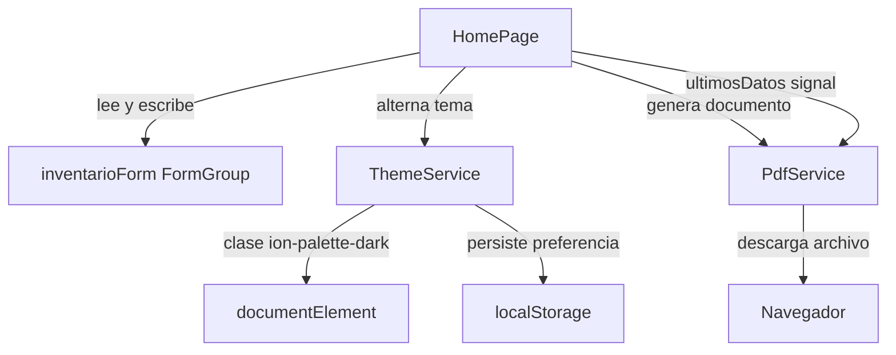
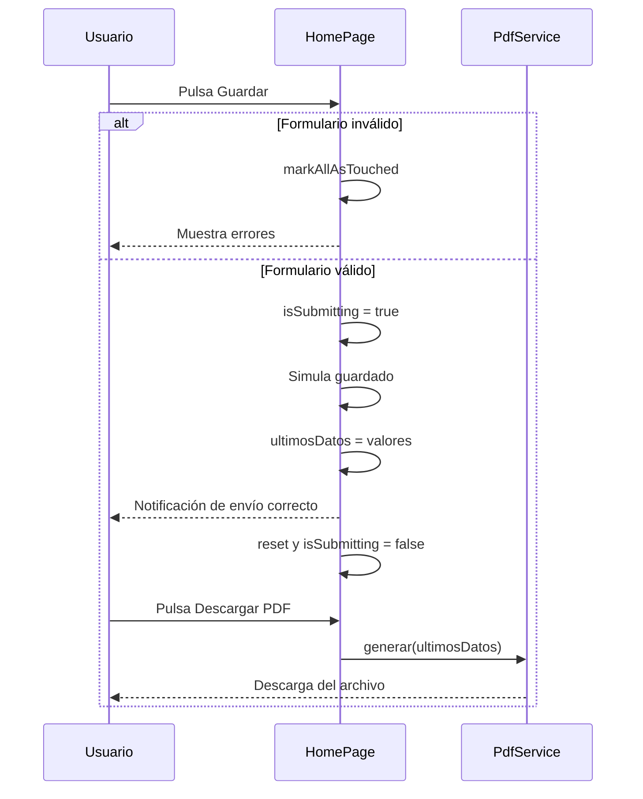

# Design Document

## Overview

El diseño cubre cinco bloques sobre la página `home` de **FormularioReactivo** (Ionic 9 + Angular 22, componentes standalone):

1. Reparar el campo de fecha de nacimiento para que abra un calendario.
2. Validar que la fecha no sea posterior a hoy.
3. Notificar el envío correcto.
4. Alternar modo oscuro / claro con una paleta lavanda y crema.
5. Descargar en PDF los datos del último envío.

La estrategia es mantener el formulario reactivo existente como única fuente de verdad del estado de los datos, extraer a servicios lo que no es propio del formulario (tema y PDF), y sustituir el mecanismo frágil de apertura del calendario por uno controlado explícitamente desde el componente.

## Diagnóstico: por qué no se abre el calendario

La implementación actual apoya la apertura del calendario en el atributo `trigger` de `ion-modal`, que empareja el modal con un elemento por su `id`. Hay dos puntos frágiles conocidos en ese montaje:

- En la primera versión, el `ion-modal` estaba **anidado dentro del `ion-item`**. Ionic espera que el modal sea un elemento hermano, no un hijo del item, porque el item distribuye sus hijos en slots y el modal queda en un contexto que no le corresponde.
- En la versión actual el modal ya es hermano, pero el `trigger` apunta a un `ion-item` que contiene un `ion-input` en modo `readonly`. El input ocupa el área del item y puede absorber la pulsación, de modo que el evento no llega al elemento que el modal vigila.

No he podido confirmar en el navegador cuál de los dos es el motivo real en tu caso, así que el diseño **elimina la dependencia del mecanismo `trigger` por completo** en lugar de intentar afinarlo. Con un modal gobernado por un `signal` desde el componente, la apertura deja de depender de la resolución de `id` y de qué elemento recibe el clic, por lo que el problema desaparece sea cual sea de las dos causas la que aplique.

## Architecture

Tres piezas, con responsabilidades separadas:



- **`HomePage`** sigue siendo el componente standalone que contiene el formulario, su validación y el estado de interfaz mediante `signal`.
- **`ThemeService`** (`providedIn: 'root'`) concentra la lógica del tema. Se saca del componente porque el tema afecta a toda la aplicación, no solo a `home` (Requirement 7.4).
- **`PdfService`** (`providedIn: 'root'`) encapsula la generación del documento. Se saca del componente para que `HomePage` no dependa directamente de la librería de PDF y para poder sustituirla sin tocar la página.

### Decisión: modal controlado frente a `trigger`

| Opción | Ventaja | Inconveniente | Decisión |
|---|---|---|---|
| `ion-datetime-button` + `ion-modal` con `trigger` | Es el patrón corto de la documentación | Depende de emparejar `id`, es justo lo que falla ahora | Descartada |
| `ion-modal` con `[isOpen]` gobernado por `signal` | Apertura explícita y depurable, sin emparejar `id` | Requiere gestionar abrir y cerrar a mano | **Elegida** |
| `ion-datetime` incrustado siempre visible | La más simple de todas | Ocupa mucho espacio y no cumple "al pinchar se abre" | Descartada |

## Components and Interfaces

### HomePage

Mantiene el `FormGroup` actual y añade:

- `calendarioAbierto = signal<boolean>(false)` — gobierna `[isOpen]` del `ion-modal`.
- `ultimosDatos = signal<DatosProducto | null>(null)` — copia del último envío correcto, base del PDF (Requirement 9.7).
- `fechaMaxima` — día actual en formato ISO, límite del calendario (Requirement 4.3).
- `valorFechaPrevio` — valor del control antes de abrir el calendario, necesario para poder cancelar (Requirement 3.3).

Métodos:

| Método | Responsabilidad |
|---|---|
| `abrirCalendario()` | Guarda el valor actual de la fecha y pone `calendarioAbierto` en cierto |
| `aceptarFecha()` | Cierra el calendario conservando lo seleccionado y marca el control como tocado |
| `cancelarFecha()` | Restaura el valor previo y cierra el calendario |
| `fechaFormateada()` | Devuelve la fecha del control en formato día/mes/año para mostrarla en el campo |
| `onSubmit()` | Valida, simula el guardado, guarda `ultimosDatos`, lanza la notificación y reinicia el formulario |
| `alternarTema()` | Delega en `ThemeService` |
| `descargarPdf()` | Delega en `PdfService` pasándole `ultimosDatos` |

El calendario se enlaza con `formControlName="fechaNacimiento"` sobre el `ion-datetime`, aprovechando que el componente de Ionic implementa `ControlValueAccessor`. Así el campo sigue siendo un control reactivo más y no hace falta sincronizarlo a mano. El `ion-modal` lleva `[keepContentsMounted]="true"` para que el control exista en el árbol desde el principio y el enlace con el formulario se establezca correctamente.

Como el enlace es directo, al seleccionar un día el valor del control cambia de inmediato. De ahí la necesidad de `valorFechaPrevio`: cancelar no es "no escribir", es "devolver lo que había".

### ThemeService

```typescript
interface ThemeService {
  readonly temaOscuro: Signal<boolean>;
  alternar(): void;
}
```

Funcionamiento:

- Estado en `signal<boolean>`, inicializado desde `localStorage` con clave `tema-preferido`; si no hay valor guardado, arranca en oscuro (Requirement 7.7).
- Aplica el tema añadiendo o quitando la clase `ion-palette-dark` en `document.documentElement`.
- Persiste cada cambio en `localStorage` (Requirement 7.6).
- Se inicializa al construir el servicio, inyectándolo en `AppComponent` para que el tema quede aplicado antes de pintar la primera página.

Cambio necesario en `src/global.scss`: sustituir la importación

```scss
@import '@ionic/angular/css/palettes/dark.system.css';
```

por

```scss
@import '@ionic/angular/css/palettes/dark.class.css';
```

Esto es imprescindible. `dark.system.css` obedece a la preferencia del sistema operativo y hace imposible el cambio manual; `dark.class.css` activa el tema oscuro cuando existe la clase `ion-palette-dark`, que es lo que el servicio controla.

### PdfService

```typescript
interface PdfService {
  generar(datos: DatosProducto): void;
}
```

- Usa **jsPDF** como dependencia, con versión exacta fijada en `package.json`.
- Compone un documento de una página con título, fecha de generación y una línea por campo.
- Formatea `fechaNacimiento` a día/mes/año antes de escribirla (Requirement 9.5).
- Llama a `save()` con un nombre de archivo descriptivo, lo que provoca la descarga en el navegador.
- Toda la generación ocurre en el cliente; no se transmite ningún dato a servicios externos (Requirement 9.8).

Alternativa considerada y descartada: `window.print()` con hoja de estilos de impresión. No añade dependencias, pero obliga al usuario a elegir "Guardar como PDF" en el diálogo de impresión y no entrega una descarga directa, que es lo que pide el Requirement 9.3.

### Controles de interfaz

- **Botón de tema**: en `ion-buttons slot="end"` dentro del `ion-toolbar` de la cabecera, con `ion-icon` de luna o sol según el estado y un `aria-label` descriptivo (Requirement 7.8). Los iconos se registran con `addIcons` de `ionicons`.
- **Botón de PDF**: bajo el botón de envío, con `[disabled]="!ultimosDatos()"` para que no esté disponible antes del primer envío correcto (Requirement 9.1).
- **Campo de fecha**: `ion-item` con `button="true"` y `(click)="abrirCalendario()"`. El `ion-input` interno se marca con `readonly` y se le desactiva la captura de puntero por CSS, de modo que la pulsación llegue siempre al item.

## Data Models

```typescript
interface DatosProducto {
  sku: string;
  nombre: string;
  categoria: string;
  stockMinimo: number;
  fechaNacimiento: string; // ISO aaaa-mm-dd
}
```

Validadores del formulario:

| Control | Validadores |
|---|---|
| `sku` | `required`, `skuValidator` (12 alfanuméricos) |
| `nombre` | `required` |
| `categoria` | `required` |
| `stockMinimo` | `required`, `min(1)` |
| `fechaNacimiento` | `required`, `fechaNoFuturaValidator` |

Nuevo validador personalizado:

```typescript
function fechaNoFuturaValidator(control: AbstractControl): ValidationErrors | null
```

Devuelve `{ fechaFutura: true }` si el valor representa una fecha posterior al día de hoy, y `null` si está vacío, delegando el caso vacío en `required` (Requirement 4.4). Comparar normalizando a inicio de día evita que la hora provoque falsos positivos.

El límite visual `[max]="fechaMaxima"` del calendario y este validador son complementarios: el primero evita que el usuario pueda elegir una fecha futura, el segundo garantiza que el formulario sea inválido si llegara a colarse por cualquier vía.

## Paleta de color

Se definen las variables en `src/theme/variables.scss`, hoy prácticamente vacío.

| Elemento | Modo claro | Modo oscuro |
|---|---|---|
| Fondo de la aplicación | Crema `#FBF6EA` | El que aporta la paleta oscura de Ionic |
| Color principal (botones) | Lila claro `#CDBCF5` | Lavanda `#A78BFA` |
| Texto sobre botones | Violeta muy oscuro `#2B1B47` | Violeta muy oscuro `#1A1026` |

Para que los botones de Ionic se rendericen bien, cada color se declara con su juego completo de variables: `--ion-color-primary`, `-rgb`, `-contrast`, `-contrast-rgb`, `-shade` y `-tint`.

Estructura:

- En `:root` van los valores del **modo claro**, incluido `--ion-background-color` en crema.
- En `.ion-palette-dark` se sobrescribe el color principal con el **lavanda**.

En ambos temas el texto de los botones es un violeta muy oscuro en lugar de blanco. Sobre colores lila y lavanda, que son claros de por sí, el texto oscuro ofrece bastante más contraste que el blanco. Conviene saber que una validación completa de accesibilidad requiere pruebas manuales con tecnologías de asistencia y revisión por una persona experta; aquí solo se elige la combinación más favorable de las dos.

## Error Handling

| Situación | Tratamiento |
|---|---|
| Envío con formulario inválido | `markAllAsTouched()` para desplegar los errores y no continuar; no se muestra notificación de éxito (Requirement 6.5) |
| Fallo durante el envío simulado | Se captura y se muestra una notificación de error en lugar de la de confirmación (Requirement 6.4) |
| `localStorage` no disponible o bloqueado | El servicio de tema captura el error y sigue funcionando en memoria, sin persistir |
| Fallo al generar el PDF | Se captura y se avisa al usuario; no se deja el botón en estado bloqueado |
| Petición de PDF sin datos previos | No puede darse porque el botón está deshabilitado, pero el servicio comprueba el nulo por seguridad |

El bloque `finally` del envío sigue devolviendo `isSubmitting` a falso, de manera que un error nunca deja el formulario bloqueado.

## Flujo de envío



## Testing Strategy

El proyecto ya trae **vitest** configurado, con `src/test-setup.ts` y el objetivo `test` en `angular.json`.

Pruebas unitarias, que son las que aportan valor real aquí porque no necesitan DOM:

- `fechaNoFuturaValidator`: fecha de ayer válida, fecha de hoy válida, fecha de mañana inválida, valor vacío sin error.
- `skuValidator`: se mantiene la cobertura de 12 alfanuméricos, longitud distinta y caracteres no permitidos.
- `ThemeService`: alterna el estado, aplica y retira la clase en el elemento raíz, persiste y recupera la preferencia, y aguanta un `localStorage` que lanza excepción.
- `PdfService`: se verifica que invoca a la librería con los datos esperados y que formatea la fecha a día/mes/año, con la librería sustituida por un doble.
- `HomePage.onSubmit`: con formulario inválido no toca `ultimosDatos`; con formulario válido lo rellena y activa la notificación.

Comprobaciones manuales, que no se pueden cubrir con pruebas unitarias:

- El calendario se abre al pulsar el campo. Es el fallo de partida, así que hay que verificarlo en el navegador, no darlo por bueno porque compile.
- Aceptar conserva la fecha y cancelar restaura la anterior.
- El botón de tema cambia fondos y botones en toda la aplicación, y el tema sobrevive a una recarga.
- El PDF se descarga y contiene los cinco campos con la fecha en formato legible.

## Trazabilidad con los requisitos

| Requirement | Cómo lo cubre el diseño |
|---|---|
| 1 | `ion-item` con etiqueta, `placeholder` y `fechaFormateada()` |
| 2 | `ion-modal` con `[isOpen]`, `presentation="date"`, `locale="es-ES"` |
| 3 | `aceptarFecha()`, `cancelarFecha()` y `valorFechaPrevio` |
| 4 | `fechaNoFuturaValidator` más `[max]="fechaMaxima"` |
| 5 | Control dentro de `inventarioForm` con `formControlName` |
| 6 | Notificación de confirmación en `onSubmit()` y rama de error |
| 7 | `ThemeService` y cambio a `dark.class.css` |
| 8 | Variables de color en `variables.scss` |
| 9 | `PdfService` con jsPDF y `ultimosDatos` |
| 10 | Etiquetas asociadas, `aria-label` del botón de tema, item como área pulsable |

## Riesgos y decisiones abiertas

- **Nueva dependencia.** jsPDF se incorpora al proyecto con versión exacta. Es una librería muy extendida y de uso habitual para esto, pero conviene que lo sepas porque el enunciado no la menciona.
- **Cambio de comportamiento del tema.** Al pasar a `dark.class.css` la aplicación deja de seguir la preferencia del sistema operativo y pasa a obedecer al botón. Es la consecuencia inevitable de poder alternarlo a mano.
- **Causa del fallo del calendario sin confirmar en navegador.** El diseño sortea el mecanismo sospechoso en lugar de corregirlo, por lo que no depende de acertar con el diagnóstico. Aun así, la verificación en navegador es obligatoria antes de dar la tarea por cerrada.
- **Colores concretos.** Los códigos hexadecimales son una interpretación de "lavanda", "lila claro" y "crema". Si tienes valores concretos en mente, es el momento de decirlos.
